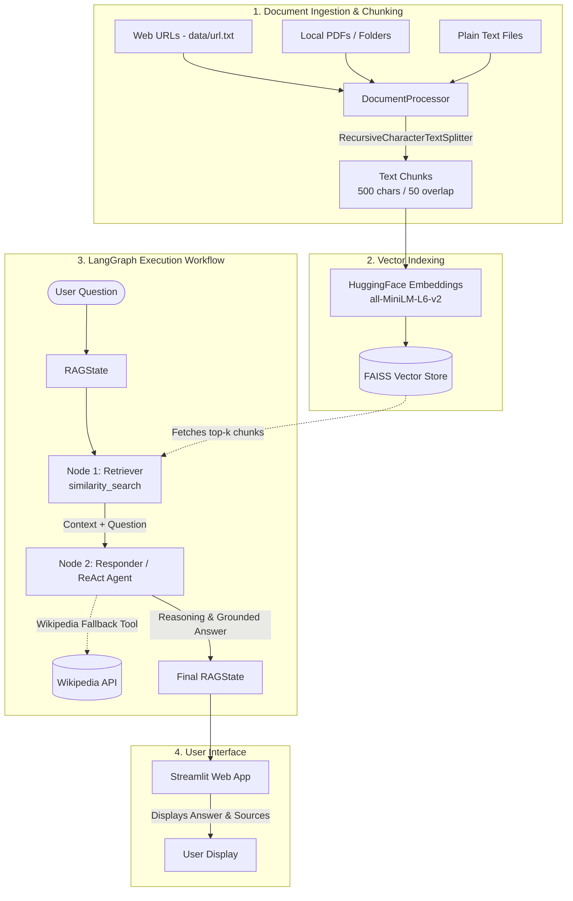
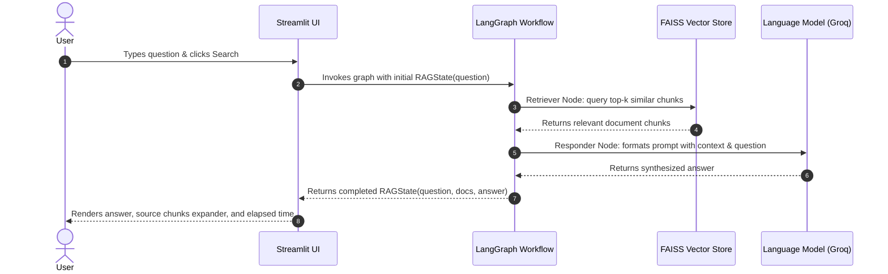

# 🤖 Agentic RAG Document Search System

An end-to-end **Retrieval-Augmented Generation (RAG)** application built with **LangChain**, **LangGraph**, **HuggingFace Embeddings**, **FAISS Vector Store**, and an interactive **Streamlit UI**.

This system ingests web articles, PDFs, and plain text files, breaks them down into context-preserving text chunks, indexes them in a local vector database, and uses a state-driven LangGraph workflow and high-speed LLM reasoning (powered by Groq) to provide answers grounded in the source material.

---

## 🏛️ System Architecture



---

## 🔄 Query & Retrieval Flow



---

## ✨ Key Features

- **Multi-Source Ingestion**:
  - Ingest directly from URLs listed in `data/url.txt`.
  - Ingest individual PDF documents or entire directories of PDFs.
  - Ingest plain text (`.txt`) files.
- **100% Free, Local Embeddings**:
  - Uses HuggingFace's `sentence-transformers/all-MiniLM-L6-v2` locally via PyTorch.
  - Zero API cost or rate limits for text vectorization.
- **In-Memory Fast Vector Search**:
  - Indexed via Facebook AI Similarity Search (`FAISS`), ensuring millisecond-level similarity retrieval.
- **LangGraph State-Machine Orchestration**:
  - Modular `RAGState` schema ensuring clean tracking across retrieval and response generation.
  - Easy extension to agentic loops, self-correction, or multi-tool architectures.
- **Optional ReAct Autonomous Agent**:
  - Includes `reactnode.py`, which provides a ReAct agent equipped with both local document retrieval and a Wikipedia fallback search tool.
- **Fast Cloud LLM Reasoning**:
  - Configured for Groq's high-speed inference engine (`openai/gpt-oss-20b`), with automatic fallback to OpenAI if configured.
- **Interactive Streamlit Web Dashboard**:
  - Clean question-and-answer search bar.
  - Expandable viewer to inspect the exact retrieved text passages.
  - Response time tracking in seconds.
  - Session-persisted search history log.

---

## 📁 Project Structure

```
Project-2/
├── .env                              # Environment variables (API keys)
├── requirements.txt                  # Python package dependencies
├── pyproject.toml                    # UV / project configuration
├── README.md                         # Project documentation and architecture
├── streamlit_app.py                  # Main Streamlit user interface
│
├── data/
│   └── url.txt                       # Default list of web URLs to ingest
│
└── src/
    ├── config/
    │   ├── __init__.py
    │   └── config.py                 # Configuration settings, chunk sizes, and LLM setup
    │
    ├── document_ingestion/
    │   ├── __init__.py
    │   └── document_processor.py     # Document loaders (URL, PDF, TXT) and text splitter
    │
    ├── vectorstore/
    │   ├── __init__.py
    │   ├── vectorstore.py            # VectorStore module interface
    │   └── vectorestore.py           # FAISS index and HuggingFace embeddings implementation
    │
    ├── state/
    │   ├── __init__.py
    │   └── rag_state.py              # Pydantic state model for LangGraph workflow
    │
    ├── nodes/
    │   ├── __init__.py
    │   ├── nodes.py                  # Standard RAG nodes (retrieve_docs, generate_answer)
    │   └── reactnode.py              # ReAct agent nodes with Retriever + Wikipedia tools
    │
    └── graph_builder/
        ├── __init__.py
        └── graph_builder.py          # LangGraph state graph compilation and runner
```

---

## 🚀 Getting Started

### 1. Prerequisites

- Python 3.10+ (or Python 3.14 via `uv`)
- A [Groq API Key](https://console.groq.com) (free) or an [OpenAI API Key](https://platform.openai.com)

### 2. Clone & Setup Environment

```bash
# Navigate to the project directory
cd c:/RAG-Projects/Project-2

# Create and activate virtual environment (using uv or standard venv)
uv venv
# On Windows:
.venv\Scripts\activate
```

### 3. Install Dependencies

Install all required packages from `requirements.txt`:

```bash
uv pip install -r requirements.txt --link-mode=copy
```

### 4. Configure API Keys

Create or edit the `.env` file in the root directory:

```env
GROQ_API_KEY="your-groq-api-key-here"
GROQ_MODEL="openai/gpt-oss-20b"

# Optional fallback:
OPENAI_API_KEY="your-openai-api-key-here"
```

---

## 💻 Running the Application

Launch the Streamlit web application:

```bash
streamlit run streamlit_app.py
```

The app will start and automatically open in your default browser at:
`http://localhost:8501`

### What Happens at Startup:
1. **Reads URLs**: Ingests articles listed in `data/url.txt`.
2. **Slices into Chunks**: Splits text into 500-character chunks with 50-character overlaps.
3. **Builds FAISS Index**: Computes vector embeddings using HuggingFace `all-MiniLM-L6-v2`.
4. **Wired Pipeline**: Connects the retriever and Groq LLM into the LangGraph state machine.
5. **Ready**: You can immediately start asking questions in natural language!

---

## 🧩 Code Architecture & Module Walkthrough

Every method across the codebase is annotated with plain-English, natural language comments:

| Module | Primary Responsibility | Key Methods |
|---|---|---|
| [`src/config/config.py`](src/config/config.py) | Centralizes configurations and loads LLMs | `Config.get_llm()` |
| [`src/document_ingestion/document_processor.py`](src/document_ingestion/document_processor.py) | Ingests URLs, PDFs, and text files; splits text | `load_from_url()`, `load_from_pdf_dir()`, `load_from_pdf()`, `load_from_txt()`, `load_documents()`, `split_documents()`, `process_urls()` |
| [`src/vectorstore/vectorstore.py`](src/vectorstore/vectorstore.py) | HuggingFace embedding generator and FAISS index manager | `create_vectorstore()`, `get_retriever()`, `retrieve()` |
| [`src/state/rag_state.py`](src/state/rag_state.py) | Shared state object that moves through LangGraph | `question`, `retrieved_docs`, `answer` |
| [`src/nodes/nodes.py`](src/nodes/nodes.py) | Standard workflow nodes for search and synthesis | `retrieve_docs()`, `generate_answer()` |
| [`src/nodes/reactnode.py`](src/nodes/reactnode.py) | Agentic ReAct nodes with multi-tool capabilities | `retrieve_docs()`, `_build_tools()`, `_build_agent()`, `generate_answer()` |
| [`src/graph_builder/graph_builder.py`](src/graph_builder/graph_builder.py) | Assembles and compiles the LangGraph state machine | `build()`, `run()` |
| [`streamlit_app.py`](streamlit_app.py) | Graphical web interface and session history | `init_session_state()`, `initialize_rag()`, `main()` |

---

## 🛠️ Customization

- **Change Ingested URLs**: Edit [`data/url.txt`](data/url.txt) by adding any article or documentation URL (one per line).
- **Adjust Chunk Size**: Modify `CHUNK_SIZE` and `CHUNK_OVERLAP` in [`src/config/config.py`](src/config/config.py).
- **Switch to ReAct Agent**: In [`src/graph_builder/graph_builder.py`](src/graph_builder/graph_builder.py), change `from src.nodes.nodes import RAGNodes` to `from src.nodes.reactnode import RAGNodes` to enable autonomous tool use and Wikipedia fallback.
