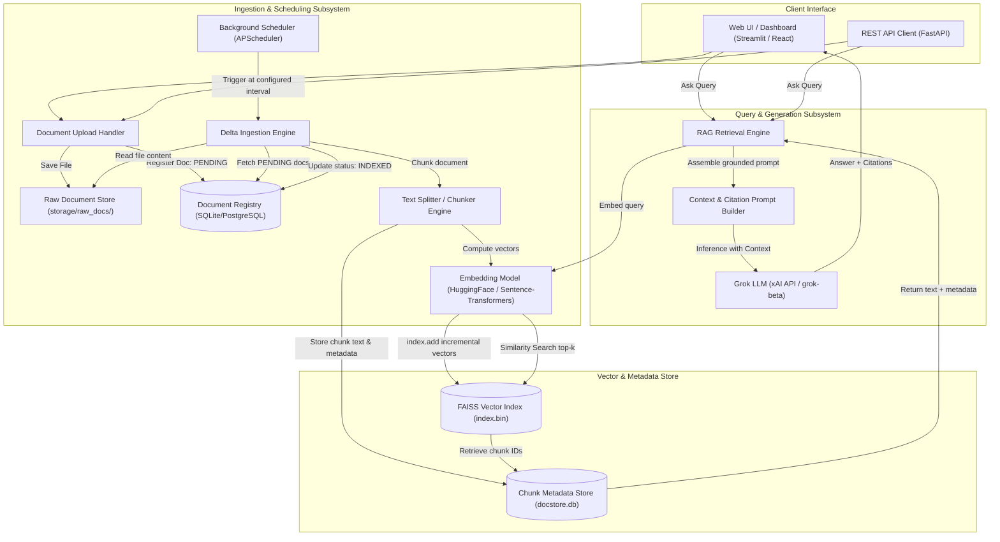
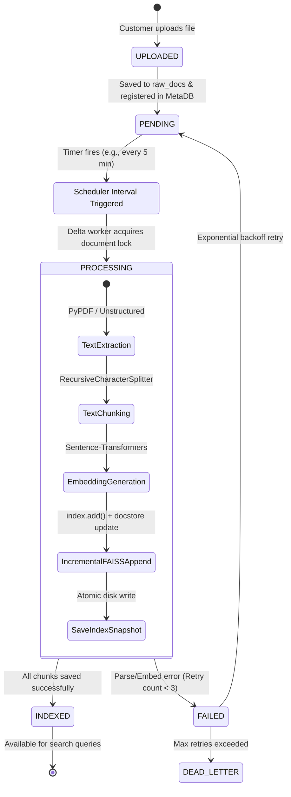
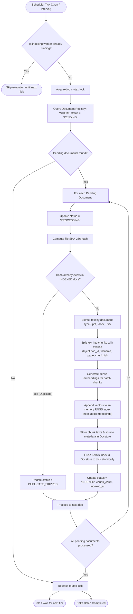
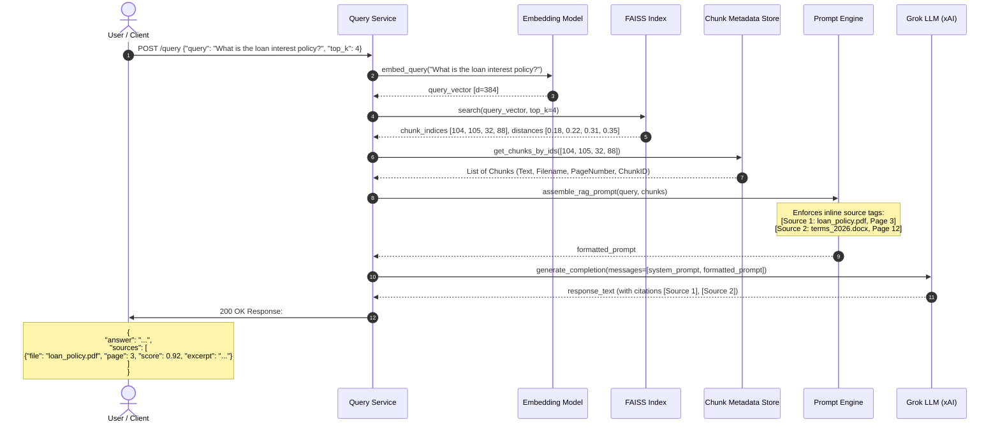

# Incremental RAG System: Architecture & Implementation Plan

A production-grade Retrieval-Augmented Generation (RAG) system with **scheduled delta ingestion**, **incremental vector indexing (FAISS)**, **Grok LLM reasoning**, and **fine-grained source attribution**.

> [!NOTE]
> **Implemented Project Location:** [Project-3/](file:///c:/Users/itsar/OneDrive/Documents/capstone/Project-3)
> **Project Documentation & User Manual:** [Project-3/README.md](file:///c:/Users/itsar/OneDrive/Documents/capstone/Project-3/README.md)
> **Active Settings:** Hourly background scheduler (`interval_hours: 1`), Free HuggingFace embeddings (`sentence-transformers/all-MiniLM-L6-v2`), and Streamlit UI.

---

## 1. Executive Summary & Core Objectives

### The Problem
Traditional RAG pipelines frequently rebuild or re-index the entire document corpus whenever new files are introduced. If 100 documents are already indexed, reprocessing the entire corpus to incorporate a 101st document wastes computational resources, inflates embedding API costs, causes index downtime, and scales poorly.

### The Solution
This system introduces an **Incremental Delta Ingestion Pipeline** managed by an automated background scheduler:
1. **Isolated Upload Stage**: Uploaded documents are securely saved to raw storage and assigned a `PENDING` state in a metadata registry with a content hash (SHA-256).
2. **Scheduled Delta Worker**: At configured time intervals, the scheduler scans only for unindexed (`PENDING`) documents. Existing documents are untouched.
3. **Atomic Incremental Vector Indexing**: Only new documents are chunked and embedded. Their vectors and metadata are appended to the persistent FAISS vector store without re-indexing historical records.
4. **Immediate Query Readiness**: As soon as a batch completes, its status switches to `INDEXED`, enabling immediate retrieval across historical and newly uploaded files.
5. **Grok LLM Synthesis with Source Attribution**: User queries retrieve top-k chunks, format context with citation tokens, and generate answers via Grok with exact document names, page numbers, and chunk references.

---

## 2. High-Level System Architecture



---

## 3. Detailed Workflow Diagrams

### 3.1 Document Lifecycle & State Machine
Every document uploaded to the system progresses through explicit lifecycle states to ensure atomicity, fault tolerance, and zero reprocessing.



---

### 3.2 Scheduled Delta Ingestion Flow
This flow explains how the scheduler isolates new files from previously processed files:



---

### 3.3 Query & Source Attribution Sequence Diagram
When a user queries the system, the RAG pipeline executes similarity search, constructs a prompt with explicit source tracking, queries Grok LLM, and formats verifiable citations.



---

## 4. Key Architectural Decisions

### 4.1 Incremental Vector Storage with FAISS
FAISS (Facebook AI Similarity Search) is an in-memory, C++ optimized vector indexing library.
- **Challenge**: Standard FAISS indices only store dense vector arrays (`float32`), not raw text or metadata.
- **Solution**:
  1. We maintain a synchronous **Docstore** (SQLite or JSON key-value store) mapping vector integer IDs (`0, 1, 2, ... N`) to their source metadata:
     `{chunk_id, doc_id, document_name, page_number, chunk_text, char_span, embedding_hash}`.
  2. For incremental ingestion, new vectors are appended via `index.add(new_embeddings)`.
  3. The current total vector count `index.ntotal` matches the next available IDs in the SQLite docstore.
  4. After each scheduled delta run, the FAISS index is flushed to disk via `faiss.write_index(index, "index.bin")` along with a companion metadata commit.

### 4.2 Scheduler Architecture
- **Engine**: `APScheduler` (Advanced Python Scheduler) running as an asynchronous background worker inside the application, or standalone via Celery / systemd / Docker sidecar.
- **Trigger**: Configurable cron expression (e.g. `*/5 * * * *` for every 5 minutes) or fixed interval (`interval: minutes=10`).
- **Concurrency & Safety**:
  - File locking (`fcntl` / Windows file mutex or SQLite transaction lock) prevents multiple ingestion workers from executing simultaneously.
  - Safe indexing: In-memory FAISS index is updated and swapped atomically using read-write locks (`threading.RWLock`), ensuring search queries can continue executing without blocking while indexing occurs.

### 4.3 Grok LLM Integration & Grounding
- **Provider**: xAI Grok API (`api.x.ai/v1`) using model `grok-beta` or `grok-2`.
- **System Directive**:
  - Direct the model to answer strictly based on provided context chunks.
  - For each assertion, require an explicit citation tag pointing to the source identifier: `[Doc: <name>, Page: <n>]`.
  - Fallback policy: When context does not contain sufficient information, Grok explicitly responds: *"Based on the uploaded documents, this information is not available."*

---

## 5. Data Models & Database Schemas

### 5.1 Document Registry Table (`documents`)
Tracks document ingestion status and prevents redundant processing:

```sql
CREATE TABLE IF NOT EXISTS documents (
    doc_id VARCHAR(36) PRIMARY KEY,
    filename VARCHAR(255) NOT NULL,
    filepath VARCHAR(512) NOT NULL,
    file_size_bytes INTEGER NOT NULL,
    file_hash_sha256 VARCHAR(64) UNIQUE NOT NULL,
    status VARCHAR(32) NOT NULL DEFAULT 'PENDING',  -- 'PENDING', 'PROCESSING', 'INDEXED', 'FAILED'
    chunk_count INTEGER DEFAULT 0,
    error_message TEXT,
    retry_count INTEGER DEFAULT 0,
    uploaded_at TIMESTAMP DEFAULT CURRENT_TIMESTAMP,
    indexed_at TIMESTAMP NULL
);

CREATE INDEX idx_documents_status ON documents(status);
CREATE INDEX idx_documents_hash ON documents(file_hash_sha256);
```

### 5.2 Chunk Registry Table (`chunks`)
Maps FAISS vector indices to source document citations:

```sql
CREATE TABLE IF NOT EXISTS chunks (
    faiss_id INTEGER PRIMARY KEY,           -- Matches FAISS vector positional offset (0..N)
    doc_id VARCHAR(36) NOT NULL,
    chunk_index INTEGER NOT NULL,
    page_number INTEGER,
    chunk_text TEXT NOT NULL,
    token_count INTEGER NOT NULL,
    created_at TIMESTAMP DEFAULT CURRENT_TIMESTAMP,
    FOREIGN KEY(doc_id) REFERENCES documents(doc_id) ON DELETE CASCADE
);

CREATE INDEX idx_chunks_doc_id ON chunks(doc_id);
```

---

## 6. Proposed Project Structure

```text
rag-incremental-system/
├── config/
│   ├── config.yaml               # System parameters (paths, intervals, chunk sizes)
│   └── settings.py               # Pydantic BaseSettings loading .env
├── src/
│   ├── __init__.py
│   ├── api/
│   │   ├── __init__.py
│   │   ├── app.py                # FastAPI application entrypoint
│   │   ├── routes_document.py    # Document upload & status check endpoints
│   │   └── routes_query.py       # Query & citation response endpoints
│   ├── core/
│   │   ├── __init__.py
│   │   ├── config.py             # App configurations
│   │   └── database.py           # SQLite / SQLAlchemy connection & ORM
│   ├── ingestion/
│   │   ├── __init__.py
│   │   ├── parser.py             # PDF, DOCX, TXT parsers
│   │   ├── chunker.py            # Text splitting with metadata enrichment
│   │   └── delta_worker.py       # Delta detection & batch processing
│   ├── vectorstore/
│   │   ├── __init__.py
│   │   ├── embedder.py           # HuggingFace / Sentence-Transformers wrapper
│   │   └── faiss_manager.py      # Thread-safe incremental FAISS index manager
│   ├── llm/
│   │   ├── __init__.py
│   │   ├── grok_client.py        # xAI Grok API client
│   │   └── prompt_templates.py   # Grounding and citation templates
│   └── scheduler/
│   │   ├── __init__.py
│   │   └── job_runner.py         # APScheduler setup & lifecycle management
├── storage/
│   ├── raw_docs/                 # Uploaded original documents
│   ├── faiss_index/
│   │   ├── index.bin             # Persistent FAISS binary index
│   │   └── index_meta.json       # Index health, version, vector dimensions
│   └── app.db                    # SQLite metadata database
├── tests/
│   ├── test_chunker.py
│   ├── test_faiss_incremental.py
│   ├── test_scheduler.py
│   └── test_rag_pipeline.py
├── frontend/
│   └── streamlit_app.py          # Interactive UI for uploads and search
├── .env.example
├── requirements.txt
└── README.md
```

---

## 7. Configuration Specification (`config.yaml`)

```yaml
app:
  name: "Incremental RAG System"
  version: "1.0.0"
  env: "development"

storage:
  raw_docs_dir: "storage/raw_docs"
  faiss_index_dir: "storage/faiss_index"
  db_path: "storage/app.db"

scheduler:
  enabled: true
  mode: "interval"               # "interval" or "cron"
  interval_minutes: 5            # Runs every 5 minutes
  max_batch_size: 25             # Process up to 25 documents per batch
  max_retries: 3

chunking:
  strategy: "recursive_character"
  chunk_size: 512                # Tokens / characters
  chunk_overlap: 64
  separators: ["\n\n", "\n", ". ", " ", ""]

embeddings:
  provider: "huggingface"
  model_name: "BAAI/bge-small-en-v1.5" # 384 dimensions, high MTEB performance
  device: "cpu"                  # "cuda" or "cpu"
  normalize_embeddings: true

vectorstore:
  type: "faiss"
  metric: "inner_product"        # Cosine similarity when normalized
  index_type: "IndexFlatIP"      # Fast, exact similarity search

llm:
  provider: "grok"
  api_key_env: "GROK_API_KEY"
  base_url: "https://api.x.ai/v1"
  model: "grok-beta"
  temperature: 0.1               # Low temperature for hallucination prevention
  max_tokens: 1024
  top_k_retrieval: 4
```

---

## 8. Implementation Roadmap (Phase-by-Phase)

| Phase | Milestone | Deliverables | Verification Criteria |
| :--- | :--- | :--- | :--- |
| **Phase 1** | **Foundations & Document Parsing** | SQLite database schema, file upload handler, PDF/DOCX/TXT parsers, hash deduplication. | Upload 10 documents; verify `PENDING` records in SQLite and files in `storage/raw_docs/`. |
| **Phase 2** | **Chunking & Incremental FAISS** | `RecursiveCharacterSplitter`, HuggingFace embedder, thread-safe `FAISSManager` with `add_documents()`. | Run ingestion on 5 docs; verify vector count. Append 2 docs; verify count increases without rebuilding previous 5. |
| **Phase 3** | **Automated Scheduler** | APScheduler integration, mutex lock, error recovery, exponential backoff. | Drop a new document in storage; wait for scheduler trigger; verify state changes from `PENDING` $\to$ `PROCESSING` $\to$ `INDEXED`. |
| **Phase 4** | **Grok LLM & Source Attribution** | xAI API integration, citation prompt engineering, metadata extractor. | Submit query; confirm answer includes `[Source: filename, Page: X]` and matches retrieved text. |
| **Phase 5** | **FastAPI & UI Dashboard** | REST endpoints (`/upload`, `/documents`, `/query`, `/sync`), Streamlit UI. | End-to-end user test via web browser: upload document, observe status, query and view citations. |
| **Phase 6** | **Hardening & Benchmarking** | Unit/Integration tests, corrupted file handling, FAISS atomic backup. | Simulate 100+ documents, system crash during write, index consistency verification. |

---

## 9. Critical Verification & Testing Strategy

1. **Incremental Ingestion Invariant**:
   $$\text{ntotal}_{\text{after}} = \text{ntotal}_{\text{before}} + \sum_{d \in \text{new\_docs}} \text{chunks}(d)$$
   Verify that existing vector representations are never recomputed or altered.
2. **Duplicate Upload Handling**:
   Uploading the identical file twice calculates matching SHA-256 hashes and sets status to `DUPLICATE_SKIPPED`, avoiding redundant vector generation.
3. **Citation Precision**:
   Every generated answer must map its citations directly back to the database `chunks` table row and the original source PDF page.
