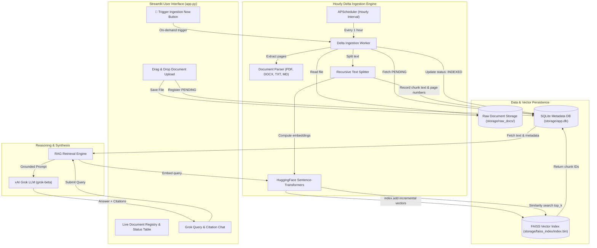

# ⚡ Incremental RAG System with Grok LLM & Scheduled Ingestion

A production-grade Retrieval-Augmented Generation (RAG) platform with **scheduled delta ingestion**, **zero-reprocessing incremental FAISS vector storage**, **HuggingFace open embeddings** (`sentence-transformers/all-MiniLM-L6-v2` or `BAAI/bge-small-en-v1.5`), and **Grok LLM reasoning with traceable source citations**.

---

## 🎯 The Core Problem & Solution

### The Problem
Traditional RAG pipelines rebuild or re-index the entire document corpus whenever new documents are uploaded. If a knowledge base has 100 documents already indexed, uploading a 101st document causes:
- Repetitive text extraction & chunking of the original 100 documents.
- Massive redundant embedding computation and API latency.
- Index locking or vector store downtime during rebuilds.

### The Solution: Scheduled Delta Ingestion
This project decouples document uploading from chunking and vector indexing:
1. **Isolated Upload State**: Newly uploaded files are safely stored in `storage/raw_docs/` and marked with `status = "PENDING"` in an ACID SQLite registry along with a SHA-256 hash.
2. **Automated Hourly Scheduler**: An APScheduler background worker fires on a configured interval (default: **every 1 hour**) and filters exclusively for `WHERE status = 'PENDING'`.
3. **Atomic Incremental Vector Append**: Only the pending documents are parsed, chunked, and converted into dense vector embeddings. These new vectors are appended directly to the persistent FAISS index via `index.add(new_vectors)`.
4. **Zero-Reprocessing Guarantee**: Historical vectors (for documents 1 through 100) are never touched or recomputed.
5. **Fine-Grained Citations**: Every query answered by Grok attributes its claims with document name, page number, chunk index, and semantic similarity score.

---

## 📐 System Architecture



---

## 🛠️ Technology Stack

| Component | Technology | Rationale |
| :--- | :--- | :--- |
| **Frontend** | Streamlit | Rapid, interactive web dashboard with real-time tables, upload widgets, and citation cards. |
| **Vector Store** | FAISS (`IndexFlatIP`) | Open-source, C++ optimized similarity search supporting normalized cosine inner-product and incremental `add()`. |
| **Embeddings** | HuggingFace `sentence-transformers` | Free, high-performance local embeddings (`all-MiniLM-L6-v2` or `BAAI/bge-small-en-v1.5`, 384 dimensions). |
| **Scheduler** | APScheduler (`BackgroundScheduler`) | Non-blocking, thread-safe cron/interval scheduling with mutex protection. |
| **LLM Reasoning** | xAI Grok (`grok-beta` / `grok-2`) | Grounded generation with strict prompt templates and fallback mock synthesis. |
| **Metadata DB** | SQLite (WAL mode) | Embedded, zero-overhead ACID relational store mapping FAISS IDs to source documents and page numbers. |
| **Document Parsers** | `pypdf`, `python-docx`, native text | Multi-format extraction with page number tracking. |

---

## 📁 Project Directory Structure

```text
Project-3/
├── config/
│   ├── config.yaml               # System parameters (hourly scheduler, embeddings, chunk sizes)
│   └── settings.py               # Pydantic configuration loader & environment variable manager
├── src/
│   ├── core/
│   │   ├── models.py             # Data schemas (DocumentRecord, ChunkRecord, Citation, RAGResponse)
│   │   └── database.py           # SQLite manager with document and chunk registry tables
│   ├── ingestion/
│   │   ├── parser.py             # Multi-format parser (PDF, DOCX, TXT, MD) with SHA-256 deduplication
│   │   ├── chunker.py            # Recursive character chunker with source metadata preservation
│   │   └── delta_worker.py       # Delta ingestion engine (processes ONLY PENDING files)
│   ├── vectorstore/
│   │   ├── embedder.py           # HuggingFace sentence-transformers wrapper
│   │   └── faiss_manager.py      # Thread-safe FAISS index manager with incremental append & atomic save
│   ├── llm/
│   │   ├── prompt_templates.py   # Grounding rules and citation templates
│   │   └── grok_client.py        # xAI Grok API client with offline/demo synthesis fallback
│   ├── scheduler/
│   │   └── job_runner.py         # APScheduler setup configured for 1-hour interval + manual trigger
│   └── pipeline/
│       └── rag_engine.py         # Retrieval, similarity matching, and citation synthesis orchestrator
├── storage/
│   ├── raw_docs/                 # Uploaded files
│   ├── faiss_index/              # Persistent FAISS index.bin and index_meta.json
│   └── app.db                    # SQLite metadata database
├── tests/
│   └── test_pipeline.py          # Unit tests verifying incremental invariance and deduplication
├── app.py                        # Streamlit web application
├── requirements.txt              # Python package dependencies
├── .env.example                  # Environment variables template
└── README.md                     # Documentation and operational manual
```

---

## ⚙️ Configuration (`config/config.yaml`)

```yaml
app:
  name: "Incremental RAG System"
  version: "1.0.0"

storage:
  raw_docs_dir: "storage/raw_docs"
  faiss_index_dir: "storage/faiss_index"
  db_path: "storage/app.db"

scheduler:
  enabled: true
  mode: "interval"
  interval_hours: 1              # Runs automatically every 1 hour
  max_batch_size: 50             # Maximum files per delta cycle
  max_retries: 3

chunking:
  chunk_size: 512
  chunk_overlap: 64
  separators: ["\n\n", "\n", ". ", " ", ""]

embeddings:
  provider: "huggingface"
  model_name: "sentence-transformers/all-MiniLM-L6-v2"
  device: "cpu"
  normalize: true

vectorstore:
  type: "faiss"
  metric: "inner_product"

llm:
  provider: "grok"
  api_key_env: "GROK_API_KEY"
  base_url: "https://api.x.ai/v1"
  model: "grok-beta"
  temperature: 0.1
  max_tokens: 1024
  top_k_retrieval: 4
```

---

## 🚀 Quickstart Guide

### 1. Installation
Navigate to the project directory and install the required dependencies:

```bash
cd Project-3
pip install -r requirements.txt
```

### 2. Configure Environment Variables (Optional for Grok API)
Create a `.env` file from the provided `.env.example`:

```bash
cp .env.example .env
```

Edit `.env` to provide your xAI Grok API key:
```ini
GROK_API_KEY=xai-your-api-key-here
GROK_MODEL=grok-beta
```
*(Note: If no API key is provided, the application automatically runs in grounded demonstration mode, synthesizing answers directly from the retrieved chunks).*

### 3. Launch the Streamlit Web Application
Run the Streamlit application:

```bash
streamlit run app.py
```

The application will launch in your browser at `http://localhost:8501`.

### 4. Running the Automated Tests
Verify incremental vector preservation and deduplication:

```bash
pytest tests/test_pipeline.py -v
```

---

## 🔍 How to Use the Application

1. **Upload Documents**:
   - Open the **📁 Document Management** tab.
   - Drag and drop your documents (`.pdf`, `.docx`, `.txt`, `.md`).
   - Click **Upload File(s) to Ingestion Queue**.
   - Your documents are instantly recorded in the Document Registry with status `PENDING`.
2. **Scheduled vs. Immediate Ingestion**:
   - The scheduler runs automatically in the background every **1 hour**.
   - If you want immediate access without waiting, click the **🚀 Trigger Ingestion Now** button in the sidebar.
   - Observe the table: status transitions from `PENDING` $\to$ `PROCESSING` $\to$ `INDEXED`.
3. **Ask Questions with Citations**:
   - Switch to the **🔍 Search & Ask Grok** tab.
   - Type your question and select how many top sources to retrieve (Top K).
   - Click **Ask Grok**.
   - View the synthesized response with inline citation tags (`[Source 1]`, `[Source 2]`).
   - Expand the **Source Citations & References** section below to view the original file name, page number, similarity score, and exact excerpt.
